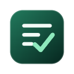
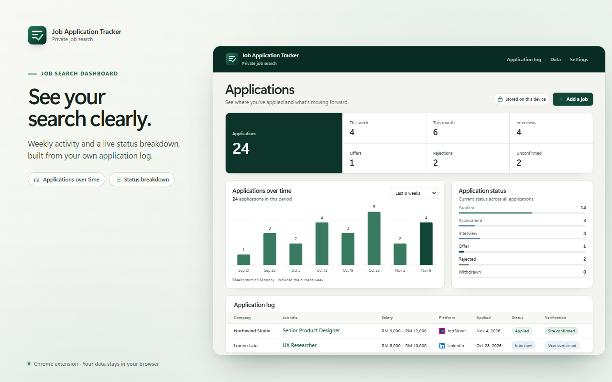

<p align="center">
  
</p>

<h1 align="center">Job Application Tracker</h1>

<p align="center">
  Save job listings, track applications, and see what’s moving forward.<br>
  Your records stay in your browser profile.
</p>

<p align="center">
  <a href="https://microsoftedge.microsoft.com/addons/detail/job-application-tracker/hcpeajnonkeacefeiihmolopfmjhhpof"></a>
</p>

<p align="center">
  <a href="#install">Install</a> · <a href="#features">Features</a> · <a href="PRIVACY.md">Privacy</a> · <a href="#contributing">Contributing</a>
</p>



## Install

| Browser | How to get it |
| --- | --- |
| **Microsoft Edge** | [Install from Edge Add-ons](https://microsoftedge.microsoft.com/addons/detail/job-application-tracker/hcpeajnonkeacefeiihmolopfmjhhpof) |
| **Firefox 147+** | [Build and load temporarily](DEVELOPMENT.md#browser-checks) |
| **Google Chrome** | [Build the Chrome package](DEVELOPMENT.md#commands), then load it unpacked from `chrome://extensions` |

Pin the extension to your toolbar and refresh any job pages you already have open.

## Features

- **Save a job from any website.** Open the toolbar popup and choose **Save current job**. Review the captured details, then save it as **Saved job** or **Applied**.
- **Track submissions on supported job boards.** The tracker observes the application flow and records site confirmations when it can verify them. You can confirm or discard unclear attempts. By default, unanswered attempts are saved as **Unconfirmed** after 10 seconds. You can change the timer in Settings.
- **Review your progress.** See weekly activity and application statuses, then search, filter, and edit your application log.
- **Export and back up your records.** Use CSV or XLSX for spreadsheets and JSON for backup and restore.

## Supported job boards

| Job site | On-site apply | Redirect to an employer’s site |
| --- | --- | --- |
| **LinkedIn** | Tracks **Easy Apply** and looks for LinkedIn’s confirmation after you submit. | Manual tracking for external **Apply** links. |
| **JobStreet Malaysia** | Tracks **Quick Apply** and looks for the JobStreet success page, even when the form opens in a new JobStreet tab. | Manual tracking for **Apply** links that leave JobStreet. |
| **MYFutureJobs** | Tracks the final **Apply** in the application popup and looks for a confirmation. | Manual tracking if the application takes you off-site. |
| **MauKerja** | Tracks **Hantar Sekarang**, **Submit Now**, and **Mohon Segera**, and looks for a success message in Malay or English. | Manual tracking if the application takes you off-site. |
| **Other websites** | Manual tracking. | Manual tracking. |

External submissions aren’t tracked automatically. Open **Save current job** from the original listing and choose **Saved job** if you haven’t applied yet. After you submit on the employer’s site, change the record to **Applied** in the dashboard. If you’ve already submitted, you can save the listing directly as **Applied**.

See the [platform guide](PLATFORMS.md) for tested flows and confirmation signals.

## Build from source

Use Node.js 26 and npm from the project folder.

```powershell
npm.cmd ci
npm.cmd run zip                         # Edge
npm.cmd run zip -- -b firefox --mv3      # Firefox and Mozilla review sources
npm.cmd run zip -- -b chrome --mv3       # Chrome
```

Packages are written to `.output/`. For local development and browser checks, see the [development guide](DEVELOPMENT.md).

## Contributing

Open a [GitHub issue](https://github.com/SeHaziq/Job-Application-Tracker/issues) to report a bug, suggest a feature, or request another job board. Include the browser, job site, and steps to reproduce, with personal application details removed. For major changes or new integrations, open an issue before sending a pull request.

[Architecture](ARCHITECTURE.md) · [Privacy policy](PRIVACY.md) · [Roadmap](ROADMAP.md) · [Release guide](RELEASE.md)
